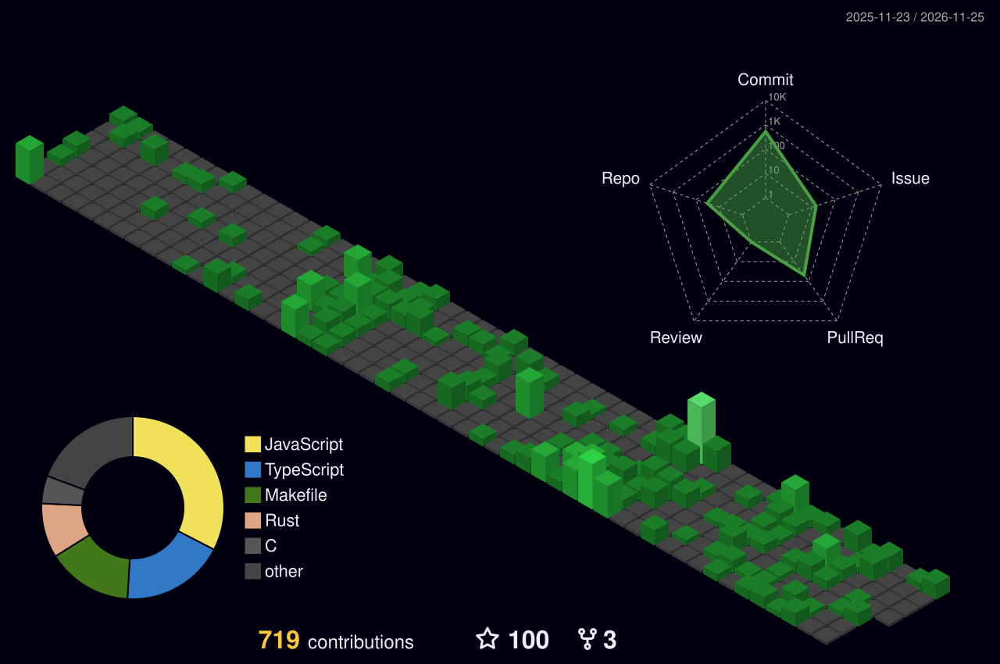

 

## Downtown

I like working on the parts of software most people never look at: protocols, network behaviour, and the checks that run before something ships. Most of what I build starts with a question I couldn't answer by reading about it.

Based in Kerala. Tabs over spaces.

## Districts

What I'm working on right now.

| District | What gets built there | Stack |
| --- | --- | --- |
| [**Halonyx**](https://github.com/ABHIRAM-CREATOR06/Halonyx) | End-to-end encrypted messenger with X3DH and the Double Ratchet implemented from scratch | Cryptography |
| [**PulseCast**](https://github.com/ABHIRAM-CREATOR06/Network-Pulse-Mapper) | Congestion simulator that treats overload as something that spreads, with a forecast engine and adaptive routing | Rust, React, D3 |
| [**AXIS**](https://github.com/ABHIRAM-CREATOR06/Acess1) | WCAG 2.2 accessibility auditing engine, built to run inside CI | .NET, JavaScript, Rust |

<b>Halonyx</b>

 

I wanted to understand the Signal Protocol properly, so I implemented X3DH and the Double Ratchet myself instead of pulling in a library. It has since grown:

- group chats with no server-side group state
- a client-side scanner that catches leaked API keys and card numbers before a message is encrypted
- a written threat model I try to keep honest

I also wrote up the protocol work in two papers.

<b>PulseCast</b>

 

It came from a simple thought: congestion behaves more like weather than like a number. Overload at one node spreads across the topology. A forecast engine tries to say where the pressure is heading before it arrives, and a few routing strategies try to get out of the way. The frontend is React and D3, so you can watch it happen.

<b>AXIS</b>

 

AXIS audits websites against WCAG 2.2. The engine is published as a package for .NET, JavaScript and Rust, so it can sit inside a CI pipeline instead of being something you run once before launch.

## Infrastructure

Applied cryptography, async networking in Rust, and tooling that makes other people's work easier to trust. I'm also getting deep into Spark and Databricks, because data infrastructure is the other half of backend work I want to understand.

## The city I built this year

Every contribution is a building. The skyline below is regenerated daily from my GitHub activity.

## Newsroom

I write up what I learn while building these on [DEV](https://dev.to/abhiramp_2005) and [Medium](https://medium.com/@abhirampraneeth2005). Most of it is the reasoning behind a design decision, not a tutorial.
